<!-- Imagens geradas por scripts/build.py (python scripts/build.py). Do tear de Jacquard ao deploy. -->

  <picture>
    <source media="(prefers-color-scheme: dark)" srcset="assets/boot.dark.svg">
    
  </picture>

  <i>“The Analytical Engine weaves algebraical patterns just as the Jacquard-loom weaves flowers and leaves.”</i> 
  “A Máquina Analítica tece padrões algébricos assim como o tear de Jacquard tece flores e folhas.” 
  — Ada Lovelace, Nota A, 1843

  Desenvolvedor de software sênior há mais de 8 anos, construindo plataformas, APIs, integrações e automações. 
  ele/dele · Florianópolis, Santa Catarina

  <picture>
    <source media="(prefers-color-scheme: dark)" srcset="assets/timeline.dark.svg">
    
  </picture>

  <picture>
    <source media="(prefers-color-scheme: dark)" srcset="assets/stack.dark.svg">
    
  </picture>

  <picture>
    <source media="(prefers-color-scheme: dark)" srcset="assets/turing.dark.svg">
    
  </picture>

  <picture>
    <source media="(prefers-color-scheme: dark)" srcset="assets/fourier.dark.svg">
    
  </picture>

  <picture>
    <source media="(prefers-color-scheme: dark)" srcset="assets/life.dark.svg">
    
  </picture>

  <a href="https://lecodaro.com"><picture>
    <source media="(prefers-color-scheme: dark)" srcset="assets/footer-lecodaro.dark.svg">
    
  </picture></a>
  &nbsp;&nbsp;
  <a href="https://www.linkedin.com/in/lenincst"><picture>
    <source media="(prefers-color-scheme: dark)" srcset="assets/footer-linkedin.dark.svg">
    
  </picture></a>

  <picture>
    <source media="(prefers-color-scheme: dark)" srcset="assets/footer-hello.dark.svg">
    
  </picture>

