<!-- Imagens geradas por scripts/build.py (python scripts/build.py). Do tear de Jacquard ao deploy. -->

  

  

  

  

  

  fundador da <a href="https://lecodaro.com">lecodaro.com</a>
  &nbsp;&nbsp;·&nbsp;&nbsp;
  <a href="https://www.linkedin.com/in/lenincst">in/lenincst</a>

